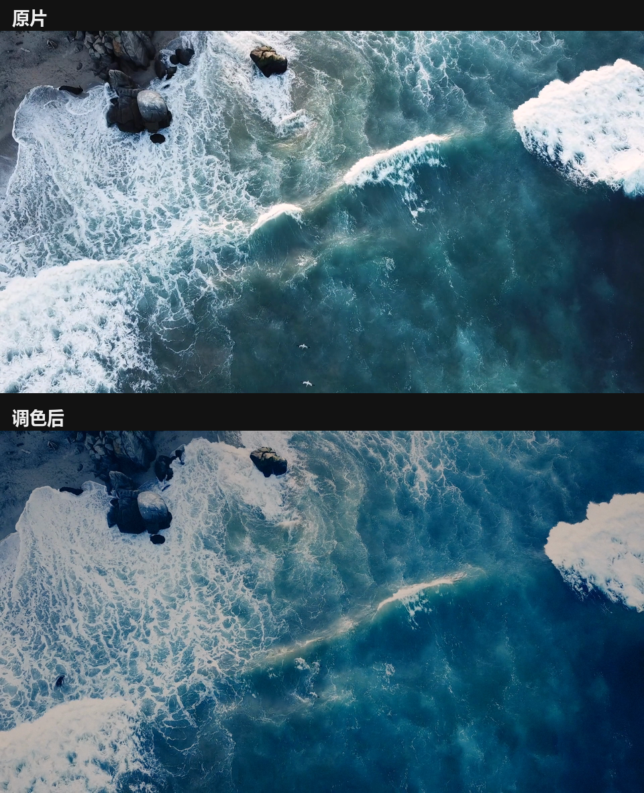

# video-look-transfer

**Parametric video look transfer** — read the style of a reference clip or still, then
grade your footage with curves, split toning, halation and grain. *No baked LUTs.*

[中文说明](README_ZH.md) · [CLI reference](docs/CLI.md) · [Agent skill](SKILL.md)



*A 5-second 1080p cut, graded with `examples/params_ocean.json`. Source: "Drone View Of
Big Waves" by Coverr on Pexels (free licence, see [Credits](#credits)).*

---

## Why not just make a LUT?

Because a graded clip is not a colour function. The look you are copying contains
**halation** (light bleeding around bright edges), local glow, a vertical gradient
and grain — all spatial effects. Bake them into a 45³ LUT and you get a transform
that reproduces average colours but destroys the bloom that made the reference look
expensive.

Measured on a real pair (a clip and its graded version, 128 frames):

| Approach | Held-out frame error |
|---|---|
| 45³ 3D LUT learned from frame pairs | **14.7 dB PSNR** (unusable) |
| Parameters (tone + split tone + halation), 16 knobs | **mean abs error 0.0196** |

So this tool keeps the grade as ~25 numbers you can read, diff, re-render and explain.
Halation, grain and the two vertical gradients stay inside the render instead of being
thrown away.

## What "reading the style" means

`sig` turns a reference into numbers — tone percentiles, cool/warm separation in the
darks and highlights, saturation, and a three-band vertical split:

```json
{ "luma": 0.224, "p50": 0.080, "p99": 0.935, "sat": 0.643,
  "shadow_rb": 0.087, "high_rb": 0.278, "clip": 0.233,
  "thirds": { "top": {"luma": 0.179, "rb": 0.173},
              "mid": {"luma": 0.337, "rb": 0.217},
              "bot": {"luma": 0.156, "rb": 0.043} } }
```

Those numbers are a **direction**, not a target: content differs, so absolute values are
not comparable between two clips. `shadow_rb` well below zero means the darks are
teal-shaped; `high_rb` above +0.2 means warm highlights; a dark top band with a warm
bottom means you need a vertical gradient. `SKILL.md` has the full translation table.

## Install

```bash
pip install numpy imageio pillow       # Pillow only for contact_sheet.py
ffmpeg -version                        # ffmpeg + ffprobe must be on PATH
```

Python 3.9+. No OpenCV, no scipy, no compiled extensions — the engine is numpy plus
pipes to ffmpeg.

## Quick start

```bash
# 1. what am I working with?
python scripts/lookgrade.py probe   myclip.mp4
python scripts/lookgrade.py metrics myclip.mp4

# 2. what does the reference look like?
python scripts/lookgrade.py sig     reference.mp4     # or reference.png

# 3. neutral starting point (edit this JSON — it is the whole tuning interface)
python scripts/lookgrade.py defaults --out _grade/params_myclip.json

# 4. iterate: change 2–3 keys, look at two timestamps, repeat
python scripts/lookgrade.py variant myclip.mp4 3.5 _grade/_ov.json v3 --params _grade/params_myclip.json
python scripts/lookgrade.py preview myclip.mp4 1.0 4.5 --params _grade/params_myclip.json

# 5. full render + proof
python scripts/lookgrade.py render  myclip.mp4 myclip_graded.mp4 --params _grade/params_myclip.json
python scripts/lookgrade.py metrics myclip_graded.mp4

# 6. optional: a LUT for Premiere / Resolve (colour only — no halation, no grain)
python scripts/lookgrade.py lut _grade/params_myclip.json LUTs/look.cube
```

Every still, preview and log lands in `_grade/`, so a run never scatters files next to
your footage.

## Commands

| Command | What it does |
|---|---|
| `probe CLIP` | resolution / fps / frames / duration / audio |
| `metrics CLIP` | tone percentiles, saturation, cool-warm split, clipping |
| `sig REF` | the same, plus a three-band vertical split — the reference side |
| `defaults --out P.json` | neutral parameter set (all 25 keys) |
| `match STILL CLIP` | still reference, different content: bounded search for a starting point |
| `preview CLIP T…` | grade the frames at those timestamps, 1280-wide PNGs |
| `variant CLIP T OV TAG` | one timestamp + an override dict — the iteration loop |
| `render CLIP OUT` | full clip, H.264, audio copied, progress to `_grade/render.log` |
| `lut P.json OUT.cube` | bake the colour part into a `.cube` |

Full flags, exit codes and environment variables: [docs/CLI.md](docs/CLI.md).

## The parameters

All in display space, 0–1. Six tone control points (`black, c1..c4, white`), then:

| Group | Keys |
|---|---|
| Split toning | `teal` (darks), `teal_mid` (midtones), `teal_g` (teal↔blue), `orange` (highlights), `rose` (magenta highlights) |
| Hue-selective | `cool_amt`, `warm_amt` — push only the pixels that are already blue / already red |
| Chroma | `sat`, `warm_sat` (warm pixels only) |
| Halation | `glow_thr`, `glow_amt`, `glow_r1`, `glow_r2` (two radii ~3 % and ~15 % of the frame) |
| Spatial | `grad_cool`, `grad_dark` (vertical), `vignette` |
| Texture | `grain`, `grain_chroma` |
| Safety | `knee`, `knee_gain` — per-channel soft highlight knee |

Suggested ranges for every key are in [SKILL.md](SKILL.md).

## Rules learned the hard way

1. **Do not chase the reference's absolute numbers.** Different content means
   incomparable `sat` / `p99`. Match the *direction*: darks go teal (`shadow_rb` more
   negative), highlights go warm (`high_rb` positive), highlights come down (`p99`
   lower), saturation goes up.
2. **Brightness-keyed toning fails on mixed lighting.** In a night shot the sodium-lit
   wall sits in the *dark* band, so "push the darks teal" paints it grey. Use
   `cool_amt` / `warm_amt`: they separate by hue, so orange walls stay orange.
3. **Soft-knee the highlights.** Hard clipping makes one channel saturate before the
   others and the hue jumps. `knee 0.94 / knee_gain 0.45` cut channel clipping from
   19.7 % to ~5 % on a test clip.
4. **Turn chroma grain off for dark footage.** 8-bit 4:2:0 amplifies chroma noise into
   blotches; luminance-only grain also dithers smooth sky gradients and prevents banding.
5. **Two timestamps minimum.** A grade that flatters one frame routinely crushes the
   next one; the loop is "change 2–3 keys → look → keep or revert".
6. **Statistics can point, not decide.** On the same reference, four hand grades landed
   at warm-cool splits from 0.15 to 0.68 (reference 0.396). A metric built on those
   numbers scored the hand-graded version *worse* than doing nothing (4.05 vs 3.26),
   which is why there is no "auto-solve to the reference" button.

## Verification, not vibes

The demo deltas are what the look asks for, not a universal target:

| | source | graded |
|---|---|---|
| saturation | 0.394 | **0.585** |
| p99 (highlights) | 0.940 | **0.713** |
| `shadow_rb` (darks) | −0.171 | **−0.308** |
| `high_rb` (highlights) | −0.089 | **+0.032** |

`clip` reports 0.208 here — that is **bottom** clipping: teal pushes the red channel of
deep-shade pixels to zero. `metrics` counts both ends on purpose; check a 100 % crop
before treating it as a problem.

## Limitations

- **No GUI.** It is a CLI plus PNG previews; you iterate by looking at files.
- **A still reference only gives direction.** `match` transfers saturation and chroma
  well, but hue only moves when the same *object* occupies the same band in both images
  (a still whose mid band is sky cannot recolour a clip whose mid band is water).
- **Per-clip tuning.** Two clips of the same scene can need different tone curves
  because their exposure differs; the split tone and grain usually carry over.
- **Render speed** is roughly 1.5–2.5 s per 1080p frame in pure numpy — fine for a few
  minutes of footage, not for a feature.

## Credits

- Demo footage: [Drone View Of Big Waves](https://www.pexels.com/video/drone-view-of-big-waves-3571264/)
  by Coverr, via Pexels — free to use, no attribution required
  ([licence](https://www.pexels.com/license/)).
- `scripts/lookgrade.py` needs `ffmpeg` at runtime but does not bundle it; ffmpeg is
  invoked as an external program.

## License

MIT — see [LICENSE](LICENSE).
