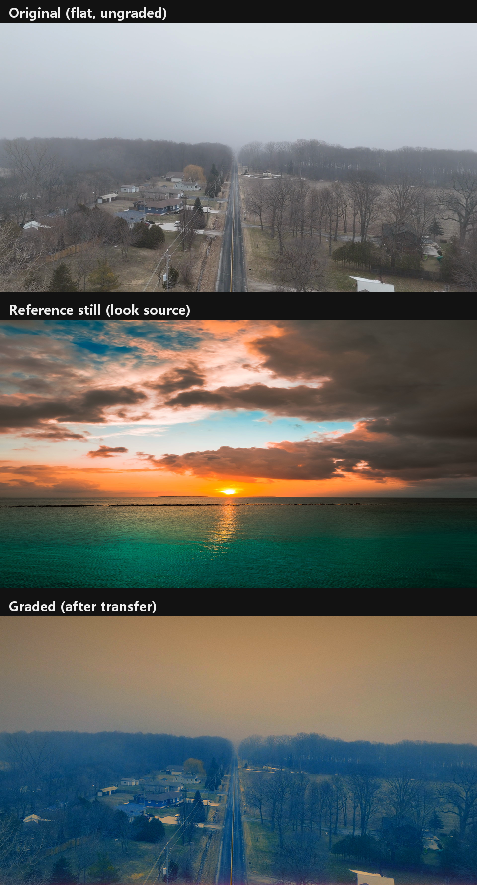

# video-look-transfer

**参数化视频调色迁移** —— 读一条参考视频（或一张参考图）的风格，用自己的素材复刻：
曲线、冷暖分离、辉光、颗粒。**不烘 LUT。**

[English](README.md) · [命令手册](docs/CLI.md) · [Agent skill 说明](SKILL.md)



*上到下：色彩平庸的原片；当作风格来源的落日参考图；同一段素材调色后的样子——同一套参数，没有烘 LUT。素材来自 Pexels（免费商用，见「致谢」）。*

*一段 5 秒 1080p 素材，用 `examples/params_ocean.json` 调出来。素材来自 Pexels 的
"Drone View Of Big Waves"（免费商用，见[致谢](#致谢)）。*

---

## 为什么不直接生成一个 LUT？

因为调色后的画面不是颜色函数。你想复刻的那种「质感」里有**辉光（halation）**、局部光晕、
垂直渐变和颗粒——全是空间性的东西。把它们烘进 45³ LUT，颜色平均值能对上，但让参考片看起来
"贵"的那层光晕没了。

拿一对真实素材（一条片子 + 它的调色版，128 帧）实测：

| 做法 | 留出帧误差 |
|---|---|
| 从帧对学 45³ 3D LUT | **14.7 dB PSNR**（不可用） |
| 参数化（影调 + 冷暖分离 + 辉光），16 个旋钮 | **平均绝对误差 0.0196** |

所以这里把调色保留成 25 个可读、可 diff、可复现的数字，辉光/颗粒/渐变留在渲染里，而不是被丢掉。

## 「读风格」读到什么

`sig` 把参考片变成一组数字——影调分位、暗部与高光的冷暖、饱和度，外加横向三分带的切分：

```json
{ "luma": 0.224, "p50": 0.080, "p99": 0.935, "sat": 0.643,
  "shadow_rb": 0.087, "high_rb": 0.278, "clip": 0.233,
  "thirds": { "top": {"luma": 0.179, "rb": 0.173},
              "mid": {"luma": 0.337, "rb": 0.217},
              "bot": {"luma": 0.156, "rb": 0.043} } }
```

这些数字是**方向**，不是目标值：内容不同，绝对值不可比。`shadow_rb` 明显为负 →
暗部是青的；`high_rb` 大于 +0.2 → 高光偏暖；顶带暗、底带暖 → 需要垂直渐变。
完整的翻译表在 [SKILL.md](SKILL.md)。

## 安装

```bash
pip install numpy imageio pillow       # Pillow 只有 contact_sheet.py 用
ffmpeg -version                        # ffmpeg / ffprobe 需在 PATH 上
```

Python 3.9+。不需要 OpenCV、scipy，也没有编译扩展——引擎就是 numpy 加管道调 ffmpeg。

## 快速开始

```bash
# 1. 先看清素材
python scripts/lookgrade.py probe   myclip.mp4
python scripts/lookgrade.py metrics myclip.mp4

# 2. 看清参考
python scripts/lookgrade.py sig     reference.mp4     # 或 reference.png

# 3. 中性起手参数（这个 JSON 就是全部的调参界面）
python scripts/lookgrade.py defaults --out _grade/params_myclip.json

# 4. 迭代：一次改 2–3 个键，看两个时间点，重复
python scripts/lookgrade.py variant myclip.mp4 3.5 _grade/_ov.json v3 --params _grade/params_myclip.json
python scripts/lookgrade.py preview myclip.mp4 1.0 4.5 --params _grade/params_myclip.json

# 5. 整片渲染 + 复核
python scripts/lookgrade.py render  myclip.mp4 myclip_graded.mp4 --params _grade/params_myclip.json
python scripts/lookgrade.py metrics myclip_graded.mp4

# 6. （可选）给 Premiere / Resolve 的 LUT，只含颜色
python scripts/lookgrade.py lut _grade/params_myclip.json LUTs/look.cube
```

所有预览、日志都落在 `_grade/`，不会在素材目录里散一堆文件。

## 命令

| 命令 | 作用 |
|---|---|
| `probe CLIP` | 分辨率 / 帧率 / 帧数 / 时长 / 有无音轨 |
| `metrics CLIP` | 影调分位、饱和度、冷暖分离、裁剪比例 |
| `sig REF` | 同上，加横三带切分——参考片那一侧 |
| `defaults --out P.json` | 中性参数（25 个键） |
| `match STILL CLIP` | 参考是**不同内容**的静帧时，有界搜索一个起点参数 |
| `preview CLIP T…` | 给指定时间点的帧调色，出 1280 宽 PNG |
| `variant CLIP T OV TAG` | 单帧 + 覆盖参数——迭代循环就是这个 |
| `render CLIP OUT` | 全片渲染，H.264，音轨直接复制，进度写 `_grade/render.log` |
| `lut P.json OUT.cube` | 把颜色部分烘成 `.cube` |

完整参数、退出码、环境变量见 [docs/CLI.md](docs/CLI.md)。

## 参数

全部在 0–1 显示空间。六个影调控制点（`black, c1..c4, white`），其余：

| 组 | 键 |
|---|---|
| 冷暖分离 | `teal`（暗部）、`teal_mid`（中间调）、`teal_g`（青↔宝蓝）、`orange`（高光）、`rose`（高光偏玫红） |
| 按色相分离 | `cool_amt`、`warm_amt`——只推本来就偏蓝/偏红的像素 |
| 饱和 | `sat`、`warm_sat`（只加强暖像素） |
| 辉光 | `glow_thr`、`glow_amt`、`glow_r1`、`glow_r2`（两级半径，约画幅 3% 与 15%） |
| 空间 | `grad_cool`、`grad_dark`（垂直）、`vignette` |
| 质感 | `grain`、`grain_chroma` |
| 安全 | `knee`、`knee_gain`——逐通道高光软膝 |

每个键的建议区间见 [SKILL.md](SKILL.md)。

## 踩出来的几条规矩

1. **别追参考的绝对值。** 内容不同，`sat` / `p99` 不可比。只对齐方向：暗部更青
   （`shadow_rb` 更负）、高光更暖（`high_rb` 转正）、高光压低（`p99` 下降）、饱和度上升。
2. **按亮度分层在混合光源下会翻车。** 夜戏里钠灯橘色墙落在暗部，"暗部推青"会把它染灰。
   用 `cool_amt` / `warm_amt` 按色相分离：偏蓝的更蓝、偏红的更红，中性灰不动。
3. **高光要软膝，不要硬夹。** 硬裁剪会让某个通道先撞顶、色相跳变；
   `knee 0.94 / knee_gain 0.45` 把实测通道裁剪从 19.7% 压到约 5%。
4. **暗片必须关色度颗粒。** 8-bit 4:2:0 会把色度噪声放大成块状色斑；纯亮度颗粒顺带充当
   天空渐变的抖动，防色带。
5. **至少看两个时间点。** 单帧好看的参数经常在另一构图上死黑或过曝。
6. **统计量只能指方向，不能定案。** 同一个参考下，手调的四条成片冷暖落差从 0.15 到 0.68
   （参考 0.396）；用这些统计量做代价函数时，手调版本打分 4.05，而"什么都不做"是 3.26——
   优化器更喜欢原片。所以没有"一键自动追平参考"这种按钮。

## 用数字证明，而不是感觉

demo 的变化方向是这个 look 想要的，不是通用目标：

| | 原片 | 调色后 |
|---|---|---|
| 饱和度 | 0.084 | **0.520** |
| 亮度 | 0.570 | **0.382** |
| p99（高光） | 0.872 | **0.585** |
| `shadow_rb`（暗部） | +0.022 | **−0.303** |
| `high_rb`（高光） | −0.061 | **+0.245** |

这里的 `clip` 是 0.208——那是**底部**裁剪：teal 把深阴影里的红通道推到 0。
`metrics` 故意两端都统计；要判断是不是问题，看 100% 裁切，别只看这个数字。

## 局限

- **没有图形界面。** 是 CLI 加 PNG 预览，迭代靠看图。
- **静帧参考只能给方向。** `match` 对饱和度和彩度迁移得不错，但色相只有在"同一个物体落在
  同一亮度段"时才会跟着动（中段是天空的静帧，改不动中段是水面的素材）。
- **每条片子要单独调。** 同场景的两条素材曝光不同，影调曲线往往不一样；冷暖分离和颗粒通常能沿用。
- **渲染速度**约 1.5–2.5 秒/1080p 帧（纯 numpy）——几分钟素材没问题，长片不合适。

## 致谢

- demo 原片：[Foggy](https://www.pexels.com/video/36411791/)（Pexels，免费商用）。
- 参考图：[Cloud Over Sea At Sunset](https://www.pexels.com/photo/cloud-over-sea-at-sunset-20141165/)（Pexels）。
- 旧海洋 demo：[Drone View Of Big Waves](https://www.pexels.com/video/drone-view-of-big-waves-3571264/)，
  作者 Coverr，来自 Pexels——免费使用、无需署名（[许可](https://www.pexels.com/license/)）。
- `scripts/lookgrade.py` 运行期需要 `ffmpeg`，但不打包它；ffmpeg 是作为外部程序调用的。

## 许可

MIT —— 见 [LICENSE](LICENSE)。
